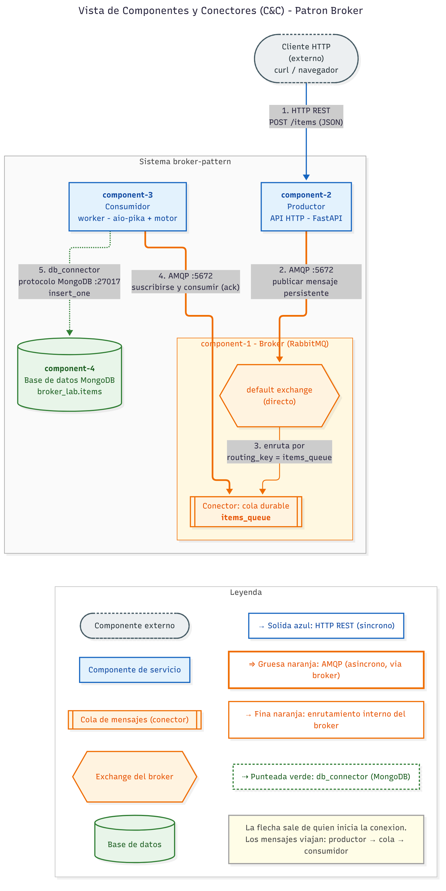
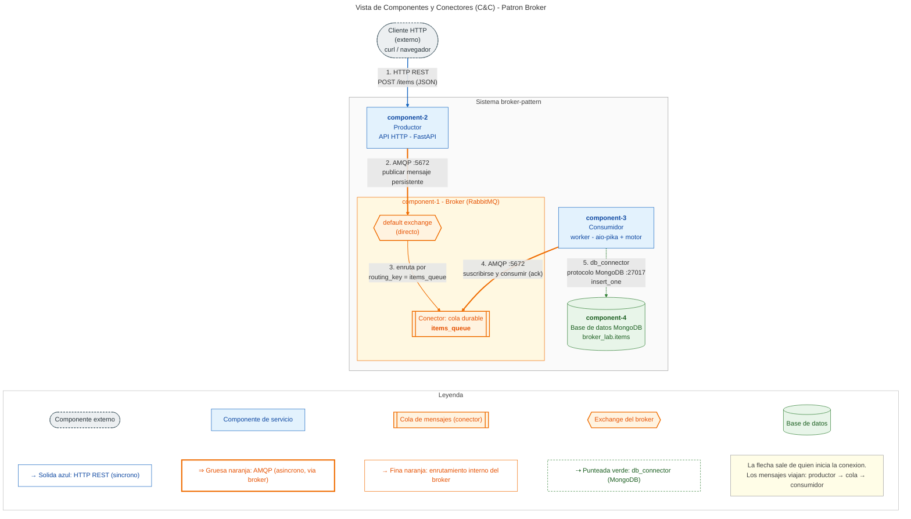
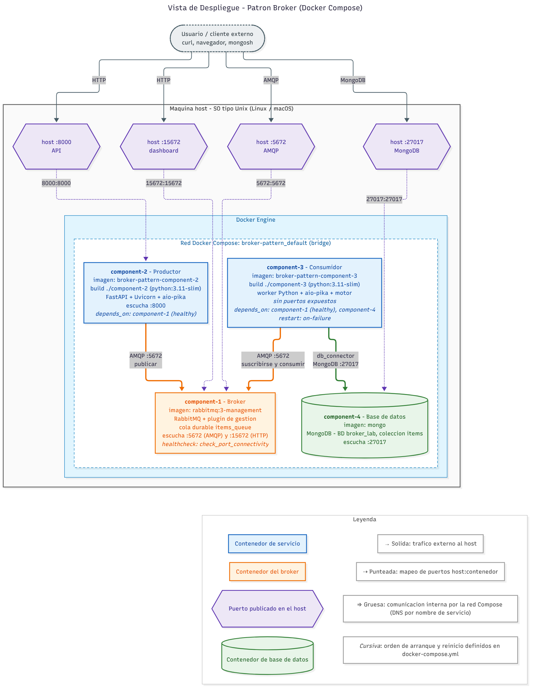
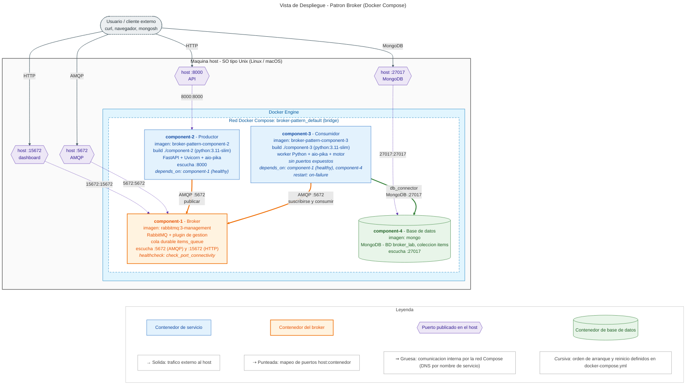

# Laboratorio 4 — Patrón Broker con RabbitMQ

Arquitectura de Software — Universidad Nacional de Colombia, 2026-II.
Laboratorio de **patrones arquitectónicos estructurales**: implementación del
**patrón Broker** con un productor HTTP (**FastAPI**), un intermediario de mensajes
(**RabbitMQ**), un consumidor asíncrono (**worker** en Python) y persistencia en
**MongoDB**, todo orquestado con **Docker Compose**.

---

## 1. Objetivo

- Implementar y ejecutar un sistema distribuido en el que los componentes se
  comuniquen **a través de un broker** y no directamente entre sí.
- Verificar el flujo completo `cliente → productor → broker → consumidor → base de datos`.
- Representar la arquitectura con una **Vista de Componentes y Conectores (C&C)**
  y una **Vista de Despliegue**.

## 2. El patrón Broker en breve

El patrón Broker introduce un componente intermediario que **desacopla** a quien
produce un mensaje de quien lo procesa:

- El **productor** (component-2) no sabe quién ni cuándo procesará el mensaje;
  solo lo publica en la cola `items_queue` del broker y responde al cliente.
- El **broker** (component-1, RabbitMQ) recibe, almacena (cola *durable*, mensajes
  *persistentes*) y entrega los mensajes a los consumidores suscritos.
- El **consumidor** (component-3) se suscribe a la cola, procesa cada mensaje
  (lo inserta en MongoDB) y confirma (*ack*) su procesamiento.

Beneficios: desacoplamiento espacial y temporal, comunicación asíncrona y la
posibilidad de escalar consumidores sin tocar al productor. Costo: un componente
más que operar y monitorear, y consistencia eventual (el cliente recibe
`published` antes de que el dato esté en la base de datos).

---

## 3. Estructura de carpetas

```
Lab4/
├── README.md                    # Este documento
├── diagramas/
│   ├── vista-cc.mmd             # Fuente Mermaid — Vista C&C
│   ├── vista-cc.png
│   ├── vista-despliegue.mmd     # Fuente Mermaid — Vista de Despliegue
│   └── vista-despliegue.png
└── broker-pattern/
    ├── docker-compose.yml       # component-1..4
    ├── component-2/             # Productor (API HTTP, FastAPI)
    │   ├── Dockerfile
    │   ├── requirements.txt
    │   └── app/main.py          # POST /items → publica en items_queue
    └── component-3/             # Consumidor (worker)
        ├── Dockerfile
        ├── requirements.txt
        └── worker/worker.py     # consume items_queue → inserta en broker_lab.items
```

| Servicio      | Rol                     | Imagen                    | Puertos al host      |
|---------------|-------------------------|---------------------------|----------------------|
| `component-1` | Broker (RabbitMQ)       | `rabbitmq:3-management`   | `5672`, `15672`      |
| `component-2` | Productor (FastAPI)     | construida desde `./component-2` | `8000`        |
| `component-3` | Consumidor (worker)     | construida desde `./component-3` | — (ninguno)   |
| `component-4` | Base de datos (MongoDB) | `mongo`                   | `27017`              |

---

## 4. Cómo ejecutar

Requisitos: Docker y Docker Compose (v2, `docker compose`).

```bash
cd Lab4/broker-pattern
docker compose up --build -d
docker compose ps
```

Salida esperada (los 4 contenedores arriba y `component-1` en estado *healthy*):

```
NAME          IMAGE                        STATUS
component-1   rabbitmq:3-management        Up 15 seconds (healthy)
component-2   broker-pattern-component-2   Up 3 seconds
component-3   broker-pattern-component-3   Up 3 seconds
component-4   mongo                        Up 15 seconds
```

> `component-2` y `component-3` arrancan ~10 s después que los demás: esperan a que
> RabbitMQ pase su *healthcheck* (ver sección 6).

Para apagar:

```bash
docker compose down
```

---

## 5. Cómo probar

**1. Publicar un ítem a través del productor**

```bash
curl -X POST http://localhost:8000/items \
     -H "Content-Type: application/json" \
     -d '{"name": "SwArch", "description": "2026-II"}'
```
```
{"status":"published"}
```

**2. Ver que el consumidor lo procesó**

```bash
docker logs component-3
```
```
[x] Waiting for messages...
[x] Item stored: {'name': 'SwArch', 'description': '2026-II', '_id': ObjectId('6ae00af1db1eb3d9b53dade4')}
```

> El log incluye `_id` porque `insert_one` de Motor/PyMongo agrega el `_id` generado
> al diccionario antes de que se ejecute el `print`. Es el comportamiento normal
> del código de la guía.

**3. Ver el documento en MongoDB**

```bash
docker exec component-4 mongosh broker_lab --quiet --eval "db.items.find().toArray()"
```
```
[
  {
    _id: ObjectId('6ae00af1db1eb3d9b53dade4'),
    name: 'SwArch',
    description: '2026-II'
  }
]
```

**4. Ver la cola en RabbitMQ**

Dashboard: <http://localhost:15672> (usuario `guest`, contraseña `guest`) → pestaña
*Queues*. Desde la terminal:

```bash
curl -u guest:guest http://localhost:15672/api/queues
```

Resultado obtenido (resumido): cola `items_queue`, `durable: true`,
`consumers: 1`, `messages: 0` (el mensaje ya fue consumido y confirmado).

**Resultado de las pruebas:** la secuencia completa (`down` → `up --build` → POST →
logs → Mongo → API de RabbitMQ) se ejecutó **tres veces desde cero** con el mismo
resultado en todas, y sin reinicios del worker (`RestartCount = 0`).

---

## 6. Ajustes realizados respecto a la guía

El código se implementó primero **exactamente** como en la guía y se ejecutó. Se
observaron dos fallas, y para cada una se aplicó la corrección mínima. El código
Python (`main.py`, `worker.py`) y los `requirements.txt` **no se modificaron**.

### 6.1 El worker se cae al arrancar (`docker-compose.yml`)

**Falla observada.** Con `depends_on` simple, `component-3` terminó con
`Exited (1)` unos 2 segundos después de iniciar:

```
aiormq.exceptions.AMQPConnectionError: [Errno 111] Connect call failed ('172.18.0.3', 5672)
```

`depends_on` solo espera a que el contenedor de RabbitMQ **inicie**, no a que
RabbitMQ esté **listo** para aceptar conexiones AMQP, lo que tarda unos 10 s. El
worker intenta conectarse antes, `connect_robust` lanza la excepción en el primer
intento y el proceso muere.

**Consecuencia: mensajes perdidos.** Con el worker caído nadie declara la cola
`items_queue`. El productor siguió respondiendo `{"status":"published"}`, pero
`/api/queues` devolvía `[]`. El *default exchange* descarta los mensajes cuyo
*routing key* no corresponde a ninguna cola existente, así que el mensaje se perdió
sin ningún error visible.

**Corrección.**

```yaml
  component-1:
    healthcheck:
      test: ["CMD", "rabbitmq-diagnostics", "-q", "check_port_connectivity"]
      interval: 5s
      timeout: 10s
      retries: 12

  component-2:
    depends_on:
      component-1:
        condition: service_healthy

  component-3:
    restart: on-failure
    depends_on:
      component-1:
        condition: service_healthy
      component-4:
        condition: service_started
```

- El `healthcheck` usa `check_port_connectivity`, que solo pasa cuando el
  *listener* AMQP (5672) ya acepta conexiones. Un `ping` simple puede pasar antes.
- Con `condition: service_healthy`, Compose no arranca el productor ni el worker
  hasta que el broker esté realmente listo, así que el worker declara la cola
  antes de que llegue el primer mensaje.
- `restart: on-failure` en el worker es una red de seguridad: si la conexión
  falla por cualquier otra razón, Docker lo reinicia en vez de dejar el sistema
  "aceptando" mensajes que nadie consume.

### 6.2 Los `print` del worker no aparecen en `docker logs` (`component-3/Dockerfile`)

**Falla observada.** Después de la corrección anterior, el documento sí llegó a
MongoDB, pero `docker logs component-3` aparecía **vacío**: no salían
`[x] Waiting for messages...` ni `[x] Item stored: ...`.

Dentro de un contenedor, la salida estándar no es una terminal, y por eso Python
la almacena en un buffer por bloques (~8 KB). Los `print` se quedan en memoria y
no llegan a Docker hasta que el buffer se llena o el proceso termina. En cambio,
el *traceback* de la falla 6.1 sí se veía porque `stderr` no usa buffer.

**Corrección.** Se agregó una línea al Dockerfile del worker:

```dockerfile
ENV PYTHONUNBUFFERED=1
```

Esta variable desactiva el buffer de stdout/stderr de Python, así que cada `print`
se escribe de inmediato y aparece en `docker logs`.

> **Nota sobre el entorno de pruebas.** Las pruebas se corrieron en un contenedor
> en la nube con un proxy HTTPS corporativo. Ahí `pip install` falló con
> `CERTIFICATE_VERIFY_FAILED`. Para compilar se usó un archivo *override* de Compose
> **local y fuera del repositorio** que solo añadía el certificado del proxy
> (`PIP_CERT`). Ese archivo no forma parte del entregable y no hace falta en una
> máquina normal.

---

## 7. Vista de Componentes y Conectores (C&C)



Fuente: [`diagramas/vista-cc.mmd`](diagramas/vista-cc.mmd)



**Componentes**

| Componente | Tipo | Responsabilidad |
|------------|------|-----------------|
| Cliente HTTP | Externo | Envía ítems al sistema (`curl`, navegador, otro servicio). |
| `component-2` — Productor (FastAPI) | Servicio | Expone `POST /items`, valida el cuerpo (`name`, `description`) con Pydantic y publica el ítem como mensaje persistente en el broker. |
| `component-1` — Broker (RabbitMQ) | Broker | Intermediario: mantiene la cola durable `items_queue` y entrega los mensajes a los consumidores suscritos. |
| `component-3` — Consumidor (worker) | Servicio | Se suscribe a `items_queue`, inserta cada mensaje en MongoDB y confirma (*ack*) el mensaje. |
| `component-4` — MongoDB | Base de datos | Persiste los ítems en `broker_lab.items`. |

**Conectores**

Los conectores siguen la sección 5 de la guía: **la cola de mensajes es el conector
principal**, y además existen `component-2 → component-1 (AMQP)`,
`component-3 → component-1 (AMQP)` y `component-3 → component-4 (db_connector)`.
Cada flecha sale del componente que **inicia** la conexión, y los números del
diagrama marcan el orden del flujo.

| # | Conector | De → A | Protocolo | Naturaleza |
|---|----------|--------|-----------|------------|
| 1 | HTTP REST | Cliente → Productor | HTTP, `POST /items` (JSON) | Síncrono, solicitud/respuesta |
| 2 | Publicar | Productor → Broker (*default exchange*) | AMQP 0-9-1, mensaje persistente, `routing_key=items_queue` | Asíncrono, *fire-and-forget* |
| 3 | Enrutamiento | *default exchange* → `items_queue` | Interno de RabbitMQ (la *routing key* es el nombre de la cola) | Interno del broker |
| 4 | Suscribirse y consumir | Consumidor → Broker (`items_queue`) | AMQP 0-9-1, `basic.consume` + *ack* | Asíncrono: el worker se suscribe y el broker le entrega (*push*) los mensajes |
| 5 | `db_connector` | Consumidor → MongoDB | Protocolo de MongoDB (driver Motor), `insert_one` | Síncrono desde el worker |

El Productor y el Consumidor **nunca se comunican directamente**: todo pasa por el
broker. Esa es la esencia del patrón.

---

## 8. Vista de Despliegue



Fuente: [`diagramas/vista-despliegue.mmd`](diagramas/vista-despliegue.mmd)



**Notas de despliegue**

- **Nodo físico:** una máquina host con SO tipo Unix (Linux/macOS) que ejecuta
  **Docker Engine**.
- **Red:** Docker Compose crea la red *bridge* `broker-pattern_default`. Dentro de
  ella los contenedores se encuentran por **nombre de servicio** (DNS interno):
  `component-1:5672`, `component-4:27017`.
- **Puertos publicados en el host:** `8000` (API del productor), `5672` (AMQP),
  `15672` (dashboard de RabbitMQ) y `27017` (MongoDB). `component-3` **no expone
  puertos**: solo abre conexiones salientes hacia el broker y la base de datos.
- **Imágenes:** `rabbitmq:3-management` y `mongo` vienen de Docker Hub.
  `broker-pattern-component-2` y `broker-pattern-component-3` se construyen
  localmente sobre `python:3.11-slim`.
- **Orden de arranque:** `component-1` y `component-4` primero. `component-2` y
  `component-3` arrancan cuando `component-1` está *healthy*.
